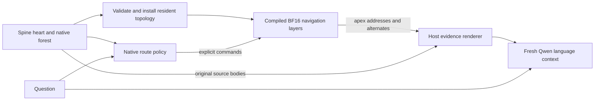
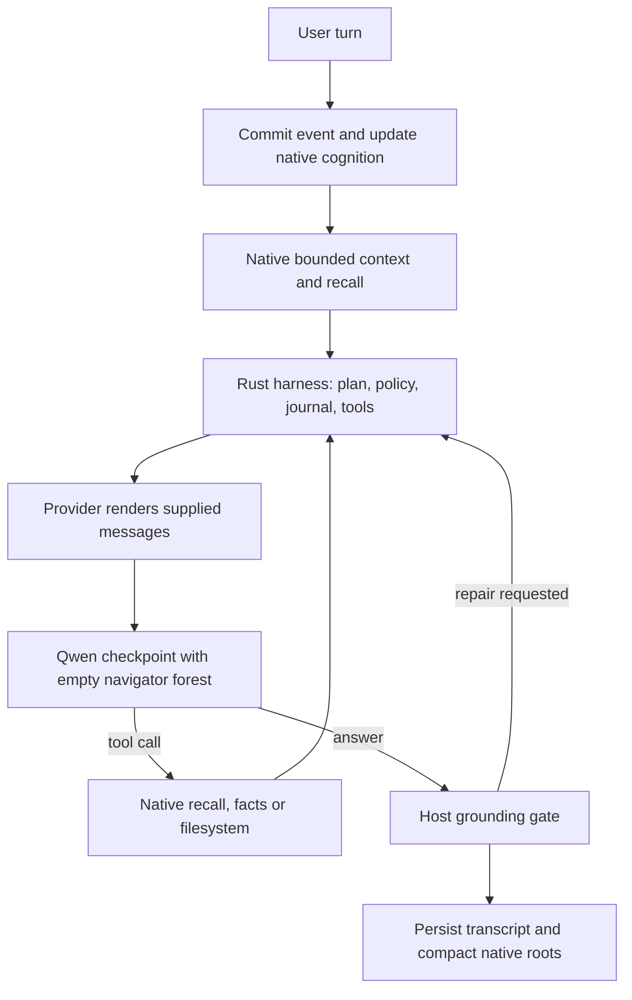

# Architecture and execution boundaries

The repository preserves a research controller at its root and a complete Rust
Spine application under `rust-spine/`. The Python package name and diagnostic
commands retain `triangle_memory`/`triangle` terminology for source compatibility.

## Compiled navigation path

This is the standalone diagnostic/retention path. It is not the current ordinary
chat path shown later in this document.

The [protocol](../src/triangle_memory/protocol.py) has 272 tokens: open, move,
alternate and apex ranges of 64 addresses each; eight saved-route tokens; and
peek, left, right, ready, invalid, limit, leaf and pad. A node record contains
`found`, `is_triangle`, apex and two child addresses. The table is fixed during
execution. Opening clears alternatives and resets the descent count. Following
an alternate retains the remaining descent budget. Slots are temporary addresses
in one verified installation, not stable event or triangle IDs.

The [forest loader](../src/triangle_memory/forest.py) verifies resolvable links,
distinct branches, no cycles, node provenance, consistent finite embeddings and
cosine coherence of at least 0.8 from apex to branch coordinates. The demo uses
synthetic coordinates; native retention uses MiniLM embeddings. A 64-record
resident bound includes both nodes and triangles. The native diagnostic installer
also rejects stored depth above eight even if a selected walk is short. The
generic Python loader can install deeper topology; its traversal still stops
after eight descents, as the depth-62 boundary test demonstrates.

The [circuit](../src/triangle_memory/circuit.py) uses five compiled layers and
five logical heads: resident records plus mutable traversal state. The
[reference](../src/triangle_memory/reference.py) is a test oracle, not a host
replacement for compiled runtime navigation. The host supplies explicit commands
and reads exact generated trace codes.

## What remains on the host

| Operation or data | Execution/storage owner |
| --- | --- |
| Installed topology, cursor, alternate routes and step counter | Compiled model recurrent state. |
| Stable IDs, source bodies, provenance and semantic vectors | Spine heart and host address map. |
| Coherent apex and eligible-pair selection | Native DCMDb/triangle code. |
| Triangle construction, folding, duplicate-root handling and chronology | Native `ContextForest`. |
| Semantic root ranking and preferred branch selection | Native query policy/rehydration. |
| Original-source selection and evidence budgets | Native renderer and memory tools. |
| Snapshot file I/O and changed-forest installation | Python/Rust host orchestration. |

Native recursion is not capped at 64 records by the compiled program. A compact
root handle retains descendants through the durable registry. Flattening an
entire native forest is what encounters this prototype's resident limit. Paging,
in-model topology mutation and the complete native triangle lifecycle are not
implemented in the controller.

## Checkpoint and dispatch

The [merge](../src/triangle_memory/merge.py) prepends five compiled layers and
widens Qwen3.5-4B from 2,560 to 2,816 residual dimensions. Padded projections and
normalization-gain changes follow Qwenputer's method. Compiled parameters are
BF16. The controller uses 185 logical residual dimensions and 217 logical
feed-forward units; these logical counts are not the full padded checkpoint
dimensions.

The runtime distinguishes circuit commands from text. Command ticks run the
compiled prefix against its navigation cache. Language generation uses a fresh
language cache and restricts output to the text vocabulary. Full-stack prefill
can pass through dormant prefix features; later text steps use the language
layers. Navigation tensors must remain unchanged during language generation.
Weights encode the program, not a user's history or installed forest.

Direct verification regenerated the prefix and matched all 70 prefix tensors
(1,242,129,280 bytes), 272 reserved command embedding rows and nine output
dimensions against the measured checkpoint. A separate small BF16 state test
disabled host forest lookups after installation and still executed correct
navigation. Clearing only resident records made open return `INVALID`; restoring
state recovered the records and cursor. This demonstrates recurrent-state
residency, not semantic compaction or a full-model language benchmark.

## Current full agent path

The [provider](../rust-spine/crates/spine-cli/src/triangle_provider.rs) uses the
normal `ModelProvider` interface and a persistent Python child running the
[backend](../rust-spine/backends/triangle/server.py). It has no heart or encoder
handle and adds no independent evidence retrieval. Native context, explicit
memory tools and the model's ordinary language reasoning remain active even
though its compiled forest is empty. A bounded harness-selected internal
installation is unfinished.

Default chat includes native hybrid automatic recall. `--triangle-context-only`
withholds that automatic recall text while retaining the task, bounded dialogue,
plans, working state, tools, policy and native triangle excerpts. It means
triangle-only *automatic memory retrieval*, not an otherwise empty context.

Normal triangle context selects three roots and bounds each rehydration at depth
eight, fanout three, 16 coordinates and 1,024 estimated tokens. The renderer emits
at most 12 excerpts of 1,000 characters. `heart_recall`/`search_memory` provide
native recovery; current heart recall emits up to 3,000-character source
prefixes and does not offer an event continuation offset. A 2,320-character
boundary fixture fits that prefix, while arbitrary longer tails need not.

Tool output uses Qwen's XML-style function/parameter format. Rust validates
arguments and returns calls to the native registry; Python does not execute
tool-call text. Schema strings remain strings, scalar `True`/`False` is supported,
and duplicate/unknown parameters or unavailable tools are rejected. Host
permissions and action budgets remain authoritative.

Language rounds allow at most 32,768 exact prompt tokens and 2,048 output tokens
(default output 1,024). Rust first estimates a message budget, preserving tool
structure and the latest task; the backend rejects a remaining exact-token
overflow. Fixed-capacity caches, 256-token prefill chunks and finite-value checks
bound and validate generation. Temperature remains subject to host modulation;
tests requesting zero still receive the host's 0.1 minimum. Output arrives at
completion boundaries rather than token-by-token streaming.

Only one completion owns a child process. Cancellation, timeout or backend
failure terminates that child; a later request starts another. Durable user
messages and tool outcomes remain in the host journal. Restart continuity comes
from reopening the heart, not from automatically restoring the raw-history KV
checkpoint or silently retaining prior language tokens.

## Persistence contracts

Navigation safetensors bind schema, forest identity, weight identity, tensor
shapes and checksums. Validation completes before live state changes. These
snapshots are separate from the heart and language cache, and are invalid after
incompatible forest/checkpoint changes.

Raw-control checkpoints bind prompt tokens, weights, capacity and position to
38 state files (one per model layer plus logits). Files are written before a
directory rename makes a completed checkpoint resumable. Restore rejects
mismatch, corruption and non-finite logits. The full-attention buffers retain all
populated positions; checkpoint shards are not independent conversations.
See [bounded cache](../src/triangle_memory/bounded_cache.py).

Checksums are integrity checks, not authentication against malicious rewriting.
Encrypted heart protection and snapshot checks have different purposes. The
[limitations](known-limitations.md) also distinguish NLI coverage from exact
source and citation verification.
